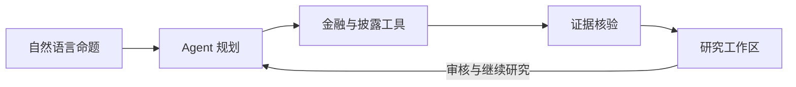

<div align="center">

# ThesisLab

**An investment research agent that turns theses into verifiable questions.**

用自然语言提出投资命题，与 Agent 一起规划研究、检查反证、追溯证据。

[](pyproject.toml) [](#development-status)

[Quick Start](#quick-start) · [Product Demo](#product-demo) · [Documentation](#documentation)

</div>


*真实产品界面 · Synthetic Demo：模型和金融数据均为合成夹具，仅展示交互流程。*

## Why ThesisLab?

> “Microsoft's valuation has declined, but its fundamentals remain intact.”
>
> 微软估值回落了，但基本面没有恶化——这个判断有哪些证据和盲点？

这样的命题同时涉及估值、经营表现和时间范围。ThesisLab 将它拆成可审查的研究问题：比较什么期间？用什么指标检验？什么材料会推翻判断？

你可以修改计划，再查看工具取得的证据及计算。即使某项财务指标得到支持，缺少估值资料时，整体命题仍会保留为**无法验证**。研究产物包括依据、反证、缺口和修订条件，帮助你继续研究。

## Features

### Natural Language Research

直接输入公司、比较、估值、行业、产业链或宏观命题，无需先填代码和报告期。Agent 理解对象与范围，关键歧义通过澄清解决。

### Dynamic Research Planning

根据命题提出不同子问题，列出支持与反对检验、所需来源及判断改变条件。你可以修改、删除或补充问题，再确认执行。

### Evidence-Backed Analysis

从实际工具结果建立来源链，查看原始位置、报告期、公式及输入。直接事实、确定性计算与模型推断分别标记。

### Bull / Bear / Unverifiable

逐个主张组织支持、反对和无法验证的证据。保留来源与口径冲突，缺失数据或工具失败不会被填成确定答案。

### Interactive Research Workspace

计划、工具记录、证据和结论放在同一工作区。继续追问、修改命题、加入比较对象，或保存后回来接着研究。

## Product Demo

以下截图通过**当前本地产品的真实浏览器操作**采集。全部为 **Synthetic Demo**，没有调用真实账户，截图中的数字不是公司实际财务数据。

**审查计划、工具过程和证据缺口。**


<details>
<summary>查看可编辑计划与证据结论</summary>

**可编辑研究计划**：修改主张、对象、观察窗口、检验标准与来源要求，再确认执行。


**证据与结论**：演示中一个背景指标得到支持，但估值资料缺失，整体命题仍无法验证。


</details>

[查看澄清、保存恢复及完整截图说明 →](docs/DEMO.md)

## Quick Start

需要 **Python 3.12+** 和 Git。在 macOS/Linux 终端运行：

```bash
git clone --branch feat/thesislab-agent-mvp https://github.com/C1ra-Gao/investment-thesis-lab.git
cd investment-thesis-lab
python3 -m venv .venv
.venv/bin/python -m pip install -r requirements.lock
.venv/bin/python -m pip install --no-deps -e .
cp .env.example .env
chmod 600 .env
```

已有项目与 `.env` 时跳过克隆和复制。用终端编辑器填写 `.env` 中的 `THESISLAB_LLM_PROVIDER`、`THESISLAB_LLM_MODEL` 和 `THESISLAB_LLM_API_KEY`。支持 DeepSeek、OpenAI、Qwen；首次仅体验规划时可将 `THESISLAB_FINANCIAL_PROVIDER` 设为 `none`。

```bash
.venv/bin/python -m thesislab.agent_server --port 8767
```

打开 **[http://127.0.0.1:8767/research](http://127.0.0.1:8767/research)**。按 Ctrl+C 停止；研究自动保存到本地，重启后可从研究库打开。

*Configure your provider in `.env`, start the server, then open the research workspace in your browser.*

点击开始会调用你的模型账户。金融查询需合法授权，公开披露需单独同意；Web 不接收或展示 API Key。切换模型后重启服务。完整 Provider、SEC 与 Docker 说明见 [Setup & Configuration](docs/SETUP.md)。

## How It Works



**模型负责理解、提议计划和受限补查；程序负责工具执行、确定性计算与证据核验。** 用户审核计划，工具能力决定可验证范围，缺口会留在研究记录中。

当前使用同源 Python / JavaScript Web、后台 Agent Runtime 与 SQLite。实现边界和内部模块复用见 [Architecture](docs/PRODUCT-GUIDE.md#architecture)。

## Documentation

- [Setup & Configuration](docs/SETUP.md) — 安装、Provider、启动与 Docker 配置。
- [Architecture](docs/PRODUCT-GUIDE.md#architecture) — Runtime、验证与持久化。
- [Evidence & Data Sources](docs/PRODUCT-GUIDE.md#data--evidence) — 来源、定位、计算及数据授权。
- [Evaluation](docs/MVP-FREEZE-2026-10-14.md) — 实际测试与验收记录；[详细记录](docs/MVP-ACCEPTANCE.md)。
- [Known Limitations](docs/PRODUCT-GUIDE.md#known-limitations) — 工具覆盖与尚未完成的验证。
- [Security](docs/PRODUCT-GUIDE.md#security) — 密钥、外部访问和本地运行边界。

历史设计、M1/M2/M4 与 API 契约保留在 [工程参考](docs/PRODUCT-GUIDE.md)，首页结构的参考依据见 [README References](docs/README-REFERENCES.md)。

## Development Status

ThesisLab 当前是单用户本地 MVP。交互链路经过合成验收，真实 LLM 已测试但计划语义仍需人工审核；真实金融数据与公开披露的在线端到端验收尚未通过，公网 DNS 安全校验限制了当前数据访问。Compose 已提供，Docker 构建/启动未验收，无公网部署。当前不支持完整行情估值、宏观因果或产业链利润份额验证。详细结果与后续工作见 [Evaluation](docs/MVP-FREEZE-2026-10-14.md) 和 [Known Limitations](docs/PRODUCT-GUIDE.md#known-limitations)。

## License

仓库目前没有 LICENSE 文件，尚未选定项目开源许可证。不能据此声明 MIT 或 Apache-2.0 授权；依赖与数据使用边界见 [Rights & Licenses](docs/RIGHTS-AND-LICENSES.md)。
