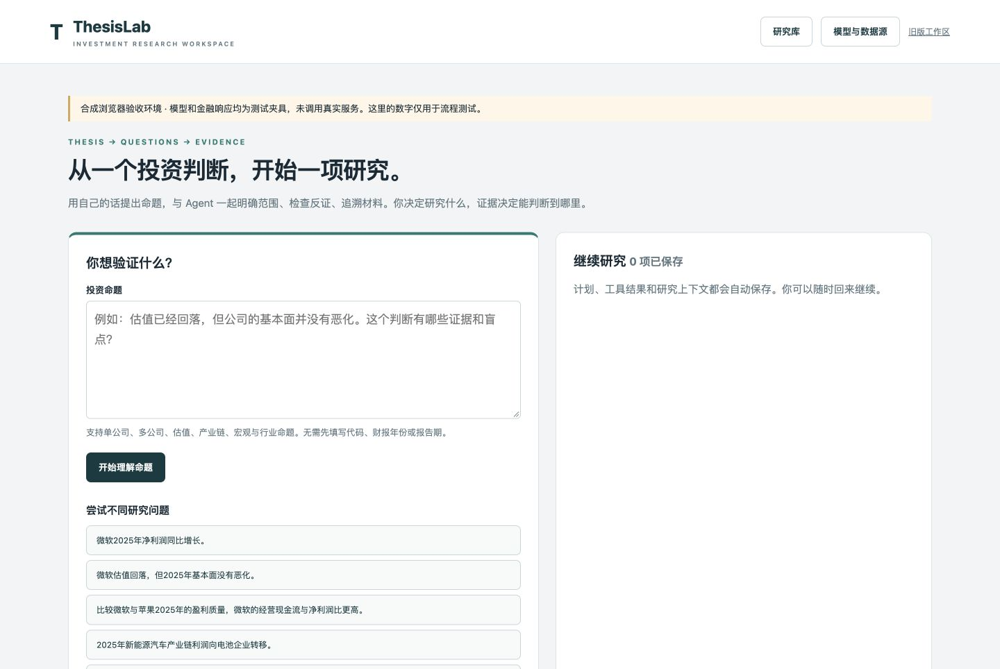
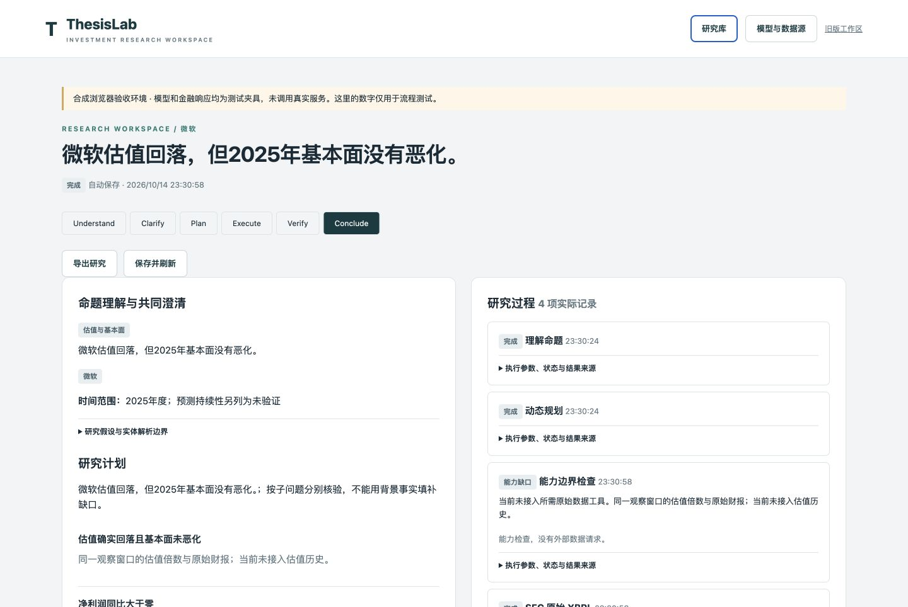
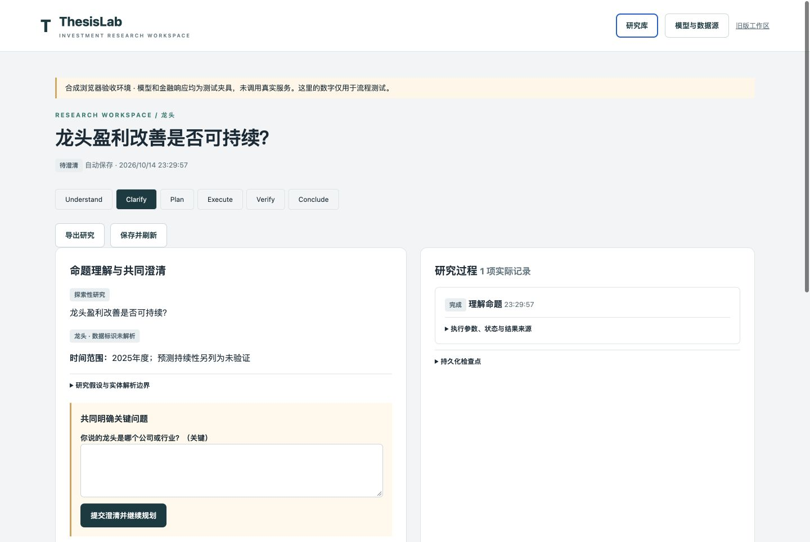
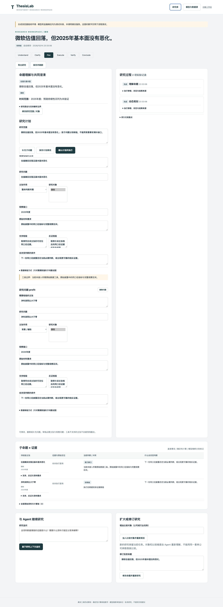
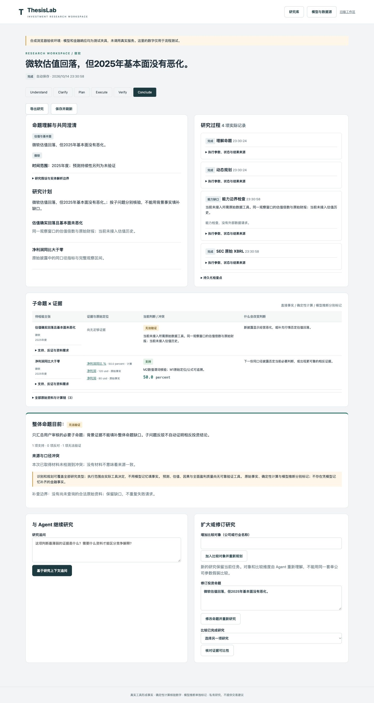
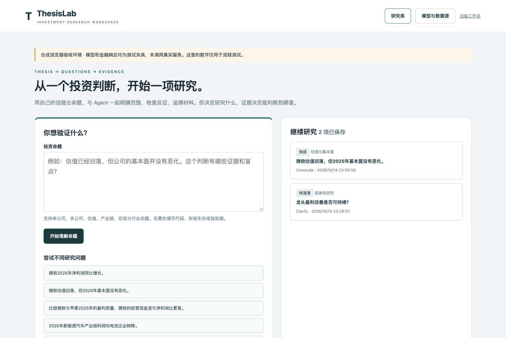

# ThesisLab Product Demo

以下均为 **Synthetic Demo**：当前产品通过真实浏览器操作呈现，模型、SEC 响应及金融数字为明确的合成夹具，不能作为真实公司研究结论。

截图使用独立端口、新建测试存储和直接注入的合成配置；未读取真实 `.env`、未访问私人研究、未调用真实模型或金融接口。未拍摄账户设置页、系统界面、私人文件路径或原始运行日志。JPEG 未添加账户或文件路径元数据。

采集使用统一的 1440 × 1000 浏览器窗口配置；截图实际可见区为 1440 × 964，计划和证据采用同宽整页长图。采集日期为 2026-10-14（Asia/Shanghai）。没有改动产品逻辑、生成虚构 UI 或修饰金融数字。

## Natural Language Entry

无需代码或报表参数，直接提出投资命题。**推荐 README 首屏**。



## Research Workspace

在同一界面审查计划、实际流程记录和能力缺口。**适合功能总览**。



## Clarification

“龙头盈利改善是否可持续？”触发主体澄清，不替用户猜一家公司。**适合理解与澄清功能说明**。



## Editable Plan

查看和编辑主张、研究对象、观察窗口、支持/反对检验及资料需求。**适合计划编辑说明，长图建议折叠或链接查看**。



## Evidence & Conclusion

演示命题：“微软估值回落，但2025年基本面没有恶化。”浏览器中实际编辑过资料要求和判断改变条件，保存后执行合成工具。

合成背景数据为净利润 120 对 80、同比 50%；这些不是微软实际数字。它只支持背景子问题，不能填补估值历史资料缺失。整体结论明确为“无法验证”。**适合证据与结论说明，长图建议折叠或链接查看**。



## Saved Research

研究库保留完成的公开演示与待澄清任务。**适合保存/恢复功能说明，不作为版本历史功能证明**。



## 复现

安装依赖后，从仓库根目录运行：

```bash
.venv/bin/python tools/serve_natural_fixture.py
```

默认演示端口为 `8768`，使用独立于正式服务的夹具配置和测试数据库。按 Ctrl+C 停止。本次采集为了避免影响已有测试状态，使用忽略目录中的隔离启动副本、端口 `8770` 和新数据库；这些运行文件不随素材提交。

截图只证明页面和合成交互，不证明真实上游数据查询成功。真实数据与模型验收状态见 [Evaluation](MVP-FREEZE-2026-10-14.md)。
