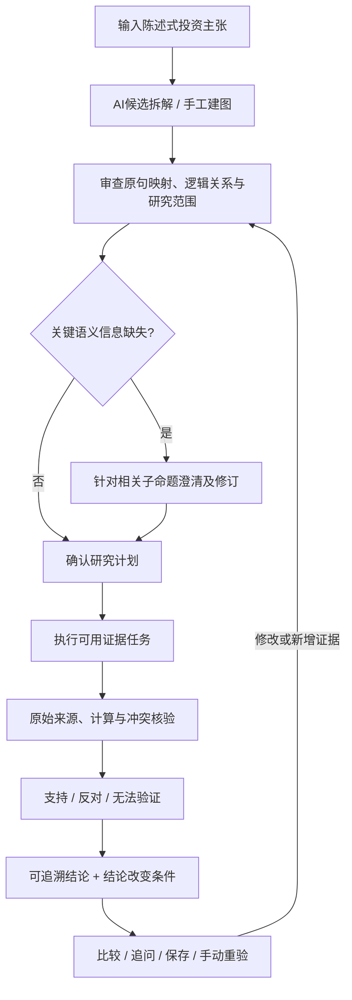

# ThesisLab｜产品需求文档（PRD）

> 投资命题与多证据验证 · 中文考题提交附件  
> 文档性质：**产品设计与验收规格**，不等于所有功能已经上线。  
> 设计基线：Phase 4 PRD、MVP Acceptance Scenarios；实现状态依据 M1/M2 完成报告及后续 DeepSeek 六次测试记录。

## 1. 产品概述

**一句话定位：** ThesisLab 是面向投资研究人员的 AI 辅助投资论点验证工作台。用户输入一条**陈述式投资主张**，系统将其组织成可检验的论证结构，以真实数据和原始材料评价证据，保留冲突与不确定性，并说明**哪些信息变化会改变当前结论**。

### 1.1 要解决的问题

- **论点难以检验**：例如“盈利改善来自主营业务”，同时包含盈利变化、主营贡献及竞争解释，不能仅用单个财务指标回答。
- **证据难以追溯**：研究结论需要对应到来源、会计范围、报告期、原表行列与计算公式。
- **冲突容易被抹平**：供应商字段、官方报告、历史披露日、累计与单季口径之间可能不一致。
- **研究无法持续维护**：新披露、数据更正、用户修改阈值后，需要判断受影响的子命题，并保留旧版本。

### 1.2 目标用户与边界

首要用户：买方投资研究员及进行公司／行业基本面分析的研究人员。产品辅助形成有证据的判断，**不提供买卖指令、自动评级、交易或资产组合操作**。

## 2. 典型投资主张

| 类型 | 用户的陈述式主张 | 验证重点 |
|---|---|---|
| 状态／背离 | 某公司估值回落，但基本面未恶化。 | 估值基准、基本面指标、两个判断的 AND 关系及不可比口径 |
| 因果／预测 | 某项外部变化将影响产业链利润分配。 | 外部事件、机制假设、竞争解释、未来观察窗口；未发生不等于被反对 |
| 盈利归因 | 某公司盈利改善主要来自主营业务。 | 盈利变化、主营贡献、非经常性因素和“主要”的判断标准 |

**关键约束：** 用户提交的是 *Investment Thesis / 投资主张*，不是要求模型直接回答的研究问题。生成的研究任务、竞争解释、模型建议都应与原始主张区分。

## 3. 核心研究闭环

**澄清是按需触发的分支。** 数据源缺失不等于用户表达含糊，不能因此反复要求用户澄清。

## 4. 核心对象与功能要求

### 4.1 投资主张拆解（Thesis → Claim Graph）

- **Thesis**：保留用户原始陈述和明确的研究范围。
- **Subclaim**：可以独立受支持、反对或暂时无法验证的**陈述式断言**，带原句位置、类型、期间、否定、量词、指标和口径。
- **ClaimRelation**：至少表示 AND/OR、必要条件、候选机制、竞争解释、比较关系；机制假设不能自动推导因果成立。
- **Evidence Task**：获取、定位、计算、反证或辨别竞争解释的**动作**，不是子命题。

**验收：** 模型生成的内容只能是候选；结构校验通过不代表保义审查通过。AI 添加的隐含条件须标记为系统建议，未经确认不得冒充原文断言。用户可修订结构、阈值和任务。

### 4.2 证据准入与三态判断

Evidence 保存事实／观点／计算的性质、原始来源链、证据定位、会计范围、披露与获取时间、核验状态。Assessment 是证据**相对于某个 Subclaim**的方向：

- **支持**：可采信证据符合已确认的判断条件。
- **反对**：可采信证据构成已确认判断的反例。
- **无法验证**：缺失来源、权限不足、口径不匹配、预测未观察、重大冲突未决等。

缺少证据不是反对；任务执行成功不是命题已经成立；支持与反对不按证据数量投票。对于 AND 主张，已确认必要反例可反对组合判断；因果／归因需要额外的辨别证据。

### 4.3 原始材料追溯与冲突

每个重要数值结论须能追溯：**结论 → 子命题 → 计算算子／证据 → 原始字段 → 官方报告页／表／行／列**。

冲突至少区分报告期间、累计／单季、合并／母公司、单位、日期／修订和同口径数值差异。允许应用有依据的转换、采用字段级官方依据、保留未决或请求补充材料。**所有原值保留，未决冲突按受影响节点阻断确定判断**。

### 4.4 明确哪些变化会改变结论

每个重要子命题关联可观察条件或无法定义条件的说明：

| 条件类型 | 含义 | 处理 |
|---|---|---|
| `falsify` 证伪 | 已定义的必要判断条件被证据否定 | 记录触发证据与受影响节点，必要时生成新判断 |
| `weaken` 削弱 | 新证据削弱支撑，但不足以构成直接反例 | 提示审查，不自动宣告主张失效 |
| `revalidate` 重验 | 披露更正、新材料、口径或阈值变化 | 标记受影响依赖并重新核验 |

每项条件记录指标／事件、算子或人工标准、时间窗口、所需来源、关联子命题、检查时间和状态。**新报告出现不自动推翻旧期间结论**。MVP 设计为手动检查，不承诺后台自动监控。

### 4.5 比较、追问与保存（产品目标）

| 操作 | 最小真实行为 | 主要失败边界 |
|---|---|---|
| **比较** | 选择两个研究对象／版本，对齐期间、单位、合并范围与指标，存储可比、可转换或不可比结果 | 数据不存在时明确列出缺口，不排名、不编数 |
| **追问** | 区分解释已有证据、验证新增事实、修订原命题；后两种派生研究任务／新版本 | 不允许使用模型记忆补齐新事实 |
| **保存** | 保存原句、图、计划、证据引用、冲突、结论、条件和运行检查点；重新打开恢复 | 网络断开不能伪装保存成功；旧版本不得覆盖 |

## 5. 页面范围（产品设计）

1. **研究库 V1**：新建主张，查找、保存、恢复历史研究。
2. **研究工作台 V2**：同一页面按阶段呈现拆解／计划／任务／证据／冲突／结论／条件，并使用抽屉查看原文与审查记录。
3. **比较 V3**：最多两个对象或版本，展示对齐结果、限制及引用。

详见 [UX 设计](UX-DESIGN.md)。

## 6. 真实基准与数据边界

已验证的内部基准：**贵州茅台 2025/2026 年 Q1 与 H1 合并利润表**。四份官方报告、八个营业收入／成本数字与既有供应商缓存一致。公式与输入可追溯；Q2 供应商 `quarterly` 标签在本案例实际对应 **H1 累计**，单季须用 H1 减 Q1。

| 已核验口径 | 收入同比 | 自算毛利率同比变动 |
|---|---:|---:|
| 2026 Q1（1–3月） | +6.5380% | −2.2144 个百分点 |
| 2026 H1（1–6月累计） | +1.4699% | −1.7441 个百分点 |
| 2026 Q2 单季（4–6月，差分计算） | −5.1417% | −1.1633 个百分点 |

因此，在限定口径下，收入增长子命题获得支持，毛利率改善子命题遭到反对。**2025 报告的供应商日期字段与官方披露日期冲突**，其内部成因未证实；原始日期不能被静默覆盖。

官方来源：[贵州茅台财务报告目录](https://www.moutaichina.com/mtgf/tzzgx/cwbg/index.html)。数据使用权仍有限制：未经确认，不公开提交供应商原始响应、内部数据库或完整受限材料；不承诺历史 point-in-time 回放及所有公司／字段覆盖。

## 7. 实现现状与设计目标的区别

| 能力 | 截至提交材料整理时的状态 |
|---|---|
| M1 原始证据、Decimal 算子、冲突、SQLite 恢复 | **已实现；Work 报告 68 项测试通过，其中 11 项使用真实材料** |
| M2 人工候选图、契约、研究计划、三态组合判断、条件检查、历史 | **已实现；M1+M2 共 112 项测试通过，无跳过** |
| DeepSeek 自动候选拆解 | **已真实调用六次**；首轮契约 0/3，第二轮 2/3；语义仍存在错误，不可视为可靠自动拆解 |
| 自动执行全部研究任务、通用因果／归因取证 | **未完成**；缺数据时必须显示无法验证 |
| 比较、追问、Web 三视图与公开 URL | **Phase 4 已设计；是否可运行须以最终构建与部署记录为准，当前不宣称通过** |

## 8. MVP 验收标准

- 原文保义和逻辑结构可审查；必要澄清不强制每次出现。
- 证据能显示支持／反对／无法验证以及具体缺口；重要数值可定位来源。
- 日期／口径重大冲突不被悄悄消除，原始值不可被审核覆盖。
- 显式展示影响判断的证伪、削弱和重验条件。
- 比较、追问、保存产生真实结果或状态记录，而非仅有按钮。
- 真实数据、合成测试、模型建议与人工裁决均分别标注。
- 公开服务需单独通过数据展示权、密钥、访问控制和部署验证。

**说明：** 本文为设计与验收规格；完整 Given/When/Then 场景见原 Phase 4 `MVP-Acceptance-Scenarios.md`。已实现能力请以仓库实际代码、测试日志和相应完成报告为准。
