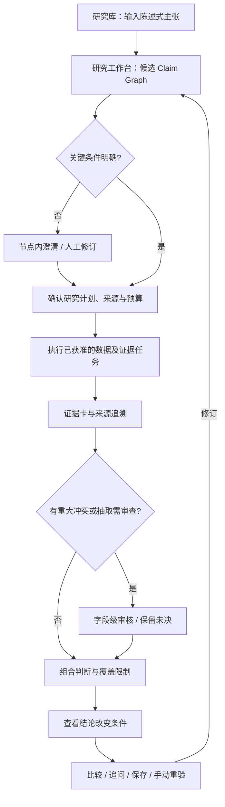

# ThesisLab｜用户流程与交互设计（UX）

> 中文考题提交附件 · 基于 Phase 4 `UX-Flows-and-Wireframes.md` 整理  
> **性质：低保真设计规格，不是 Web 已上线或全部功能可用的证明。**

## 1. 交互原则

ThesisLab 的第一交互对象是**投资主张及其论证结构**，不是聊天窗口。AI 为研究者提出候选拆解，用户负责确认论点含义；程序进行来源核验与确定性计算，研究者审查冲突。

- **先呈现候选图，再按需澄清**：不把聊天式问卷设为强制第一步。
- **原始主张始终可见**：新增前提与竞争解释标记“系统建议，未确认”。
- **证据可点击回源**：从结论能进入公式、输入值、原表行列和披露时间。
- **未知要显式展示**：数据缺口、网络失败、预测未观察、证据冲突分别标注。
- **保存研究状态，不只是保存文字**：包含版本、任务进度、审核决策、变化条件和待解决问题。

## 2. 主用户旅程



研究阶段不是聊天轮次；V2 一个工作台复用不同状态，尽量不让用户在多个独立页面之间跳转。

## 3. 信息架构：三个主视图

### V1 研究库｜创建与恢复

**用户目标：** 输入新投资主张，或打开已有研究。

```text
┌ ThesisLab · 我的研究 ─────────────────────────────────────┐
│ 验证投资主张，而非生成买卖建议                            │
│ [写下一条陈述式投资主张……                              ] │
│                                   [解析并审查命题 →]    │
│ 数据范围：已验证案例与字段有限，其他需逐项核验             │
├ 我的研究 ───────────────────────────────────────────────┤
│ 标题 / 研究对象      版本 / 运行      状态               │
│ 收入与毛利改善        r1 / run1        已核验，日期未决    │
│                                       [继续研究] [比较]  │
│ 盈利改善来自主营      草稿             数据缺口            │
│                                       [继续编辑]         │
└─────────────────────────────────────────────────────────┘
```

交互：提交原句后创建草稿并进入 V2；研究库读取已保存任务状态，不能用静态列表冒充持久化。列表失败显示重试，而不是“没有研究”。

### V2 研究工作台｜候选拆解与研究计划

**用户目标：** 看懂系统怎样拆分判断，修改结构并确认需要什么证据。

```text
┌ 研究：2026 Q1/H1 收入增长且毛利率改善     [保存研究] ────┐
│ 原主张：[完整原句]                         [修订原句]     │
│ 步骤：命题草案 → 研究计划 → 证据 → 结论                    │
├ 命题结构 ─────────────────┬ 当前节点与验证计划 ──────────┤
│ 根：AND                    │ C3 毛利率同比改善 [编辑]     │
│ ├ C1 Q1收入同比增长        │ 口径：合并、同比、Q1          │
│ ├ C2 H1收入同比增长        │ 条件：改善 > 0pp（待确认）    │
│ ├ C3 Q1毛利率改善          │ 支持任务：核验收入/成本       │
│ └ C4 H1毛利率改善          │ 反证任务：检查同比≤0          │
│ [添加断言] [查看关系]       │ 来源能力 / 时间 / 预算        │
│ 系统建议：标记为未确认     │ [必要时：针对本节点澄清]     │
├ 变化条件 ─────────────────┴─────────────────────────────┤
│ [审查证伪/削弱/重验条件]  未定义的观察项显示缺口           │
│ [继续编辑]                        [确认计划，开始验证]    │
└─────────────────────────────────────────────────────────┘
```

规则：用户确认研究范围、逻辑关系及模型新增假设前，不能自动取数并给确定结论。对于因果题，须保留“假设机制→预测结果”和竞争解释，不转换成普通问题清单。条件未定义可先保存草稿。

### V2 研究工作台｜验证结果与持续研究

```text
┌ 研究：收入与毛利 · r1/run1       [保存] [历史] [手动重验] ┐
│ 状态：任务已处理；日期原因仍未决                          │
├ 命题结构 ────────────────┬ 证据与当前判断 ───────────────┤
│ C1 支持：Q1收入增长       │ 组合主张：反对（指定范围）     │
│ C2 支持：H1收入增长       │ [支持] [反对] [无法验证]       │
│ C3 反对：Q1毛利率改善     │ E3 毛利率差 -2.2144pp         │
│ C4 反对：H1毛利率改善     │ [来源／公式／原报告p8]         │
│                           │ 冲突：供应商日期≠官方披露日    │
│                           │ [审查冲突] [保留未决]          │
├ 哪些信息会改变判断 ─────────────────────────────────────┤
│ 同期财报更正 → 受影响字段重算    [查看] [检查]            │
│ 说明：不是自动行情监控                                    │
├ 继续研究 ───────────────────────────────────────────────┤
│ [追问：为什么Q2不能直接当作单季？                      ] │
│ [提交追问] [比较版本／对象] [修订主张] [保存并返回]        │
└─────────────────────────────────────────────────────────┘
```

**审查状态与研究判断分离**：进度 4/4 仅指任务数，不代表结论可信度 100%；日期语义未决不必自动推翻已独立核验的数字。重大同口径数值冲突则阻断受影响节点。

### V2 抽屉交互：原始证据

```text
来源与计算 · E3
事实类型：程序计算；用于 C3；原数已交叉核验
公式：(营业收入－营业成本) / 营业收入 × 100
输入：2026Q1收入、成本；2025Q1收入、成本
供应商字段：/data/item/1/operating_income
官方定位：2026第一季度报告 / 合并利润表 / p8 / 本期列
披露日期与获取日期分开显示
[打开官方原报告] [查看全部计算依赖]
```

如果无授权保存全文，应只展示获准元数据和原站链接，不在公网页面暴露本地路径、Key 或私有响应。

### V2 抽屉交互：冲突、变化条件、修订

```text
日期差异：2025 H1
供应商 report_date_ms：2026-08-15
官方披露日：2025-08-13
影响：历史公开可知时间，不影响当前已核对原始数值
[采用官方日作为“原始披露日”] [保持未决]
残余问题：供应商字段具体语义未知

变化条件：官方同期间利润表更正
类型：需重验 / 观察窗口：2026 Q1-H1 / 影响节点：C1-C4
[编辑条件] [检查影响]  状态：尚未检查新材料

修改：H1累计 → Q2单季
可复用：H1/Q1收入和成本；需重新计算：单季、同比、毛利率
[确认修订 → 新版本]；旧运行保持不变
```

### V3 比较｜口径先行

**用户目标：** 比较两个保存的研究对象／版本，并理解何处可比、何处不可比。

```text
┌ 比较研究：左 r1/run1    右 r2/run2 ──────────────────────┐
│ [选择左侧]   [选择右侧]          [检查可比性]            │
├ 对齐维度 ───────┬ 左 ────────────┬ 右 ─────────┬ 结果 ┤
│ 财务范围        │ 合并            │ 合并         │ 一致 │
│ 单位            │ 人民币元        │ 人民币元     │ 一致 │
│ 期间口径        │ H1累计          │ Q2单季      │ 不同 │
│ 证据状态        │ 已核验          │ 差分推导     │ 说明 │
├ [转换计算及来源] [保留不可比原因] [保存比较]            ┤
└─────────────────────────────────────────────────────────┘
```

比较必须保存两侧 revision/run、对齐选择和结果。不允许把 H1 累计与 Q2 单季当作同口径结果直接排名；新公司的证据未知时，显示缺口而不是填入占位数字。

## 4. 关键交互分支与失败处理

| 触发 | 应展示的反馈 | 允许操作 |
|---|---|---|
| 原句条件不完整 | 已拆出的节点 + 具体歧义 | 在对应节点澄清并保存草稿 |
| 模型生成了不合理断言 | 标记候选／系统建议、语义未审核 | 人工删除、修订、重新确认 |
| 金融数据缺字段 | 无法验证：字段或来源缺失 | 补充获准材料、保存缺口 |
| JSON 不完整／权限不足 | 获取失败（不同于验证不成立） | 合规重试或保存部分结果 |
| 同口径数字重大冲突 | 指出影响哪些子命题 | 人审或保留未决，不能强判 |
| 因果预测窗口未结束 | 尚未观察，无法验证 | 设置观察条件，等待以后重验 |
| 解释性追问 | 从已有证据闭包回答并引用 | 保存 Followup，不暗中取新数据 |
| 新事实追问 | 建议新的验证任务／分析窗口 | 用户确认后执行新 run |
| 保存失败或断网 | 明示未保存成功 | 重试，不虚构持久化 |

## 5. 设计验收标准与实施边界

设计验收看的是实际用户动作及状态变化：原文保义、必要澄清可跳过、来源可回溯、重大冲突可保留、变化条件可检查、比较有对齐结果、追问有增量任务或引用、保存可恢复版本。

**当前实现边界：** 已完成的 M1/M2 主要是离线可信证据链、人工候选研究图、研究计划和确定性验证，具有 CLI 与 SQLite 持久化；DeepSeek 曾真实生成候选，但六次评测仍有明显保义和逻辑错误。本文 V1–V3 是 Phase 4 的产品交互**设计稿**；无最终 Web E2E / 公开部署凭据前，不将这些线框图称为已上线界面。

## 6. 与其他文档的关系

- [产品 PRD](PRODUCT-PRD.md)：需求范围、角色、核心对象与验收标准。
- 原 Phase 4 `MVP-Acceptance-Scenarios.md`：更完整的 Given/When/Then 验收场景。
- 仓库根目录 `README.md`：已实现能力、运行命令和实际测试记录。
